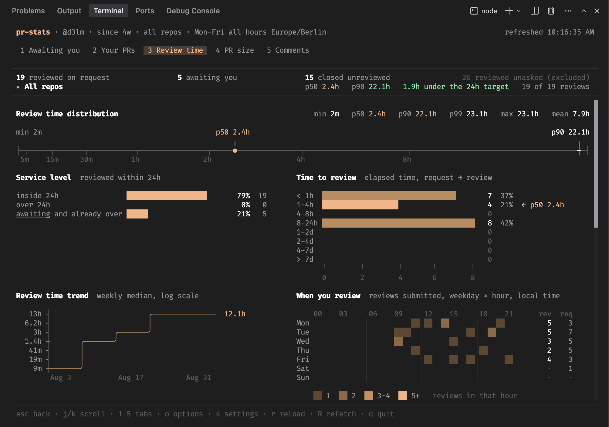

# pr-stats

Track GitHub pull requests (PRs), review requests, and mentions from your terminal. See how long reviews take, how large PRs grow, and where discussion happens.



## Get started

Use Node.js 26.4+ or Bun 1.3+. For GitHub access, install the GitHub CLI (`gh`) and sign in.

```bash
gh auth login
npm install -g @d3lm/pr-stats
pr-stats
```

To run without installing, use `npx @d3lm/pr-stats` or `bunx --bun @d3lm/pr-stats`.

On the first run, pr-stats shows your statistics for PRs created in the last 90 days across repositories you can access. Older open PRs still appear in your review queue when they await your review.

### Use a GitHub token

You can use `GITHUB_TOKEN`, `GH_TOKEN`, or `--token <token>` instead of the GitHub CLI. The token must have access to the repositories you want to see.

A classic token needs `repo` for private repositories, or `public_repo` for public repositories only. Add `read:org` for team review requests. A fine-grained token needs repository access and read permissions for Metadata, Pull requests, and Contents. Team review requests also need read access to organization members.

If repositories are missing, make sure that your token has access and any required organization approval. Run `pr-stats --repo owner/name` to surface an access error for a specific repository.

## Use the dashboard

- Awaiting you lists review requests for you and your teams, PRs you already reviewed, and mentions.
- Your PRs shows your open PRs and statistics for merged and closed PRs.
- Stats has three sub-tabs. Review time shows review times, trends, and pending requests. PR size shows changed lines, changed files, and trends. Comments shows discussion activity and the most commented PRs.

When several repositories have data, choose one repository or the combined view.

| Key                             | Action                                                 |
| ------------------------------- | ------------------------------------------------------ |
| `1`–`3` or `tab` / `shift+tab`  | Switch tabs.                                           |
| `t` / `T`                       | Switch sub-tabs within a tab.                          |
| `↑` / `↓` or `k` / `j`          | Move through lists or scroll charts.                   |
| `pgup` / `pgdn`, `home` / `end` | Scroll charts by half a screen, or to either end.      |
| `enter`                         | Open the selected repository or PR.                    |
| `esc`                           | Go back or close a dialog.                             |
| `s`                             | Snooze a review request or mention, or end its snooze. |
| `d`                             | Mark a mention read or unread in Mentions.             |
| `r` / `R`                       | Reload data, or refetch without the cache.             |
| `o`                             | Open filters and targets.                              |
| `S`                             | Open settings.                                         |
| `q`                             | Quit.                                                  |

The footer shows the controls for your current view. The Mentions inbox marks existing mentions as read on its first load, so only later mentions appear as unread.

## Filter and export statistics

```bash
# Limit the report to one repository and the last 30 days.
pr-stats --repo owner/name --since 30d

# Include several repositories.
pr-stats --repo owner/frontend --repo owner/backend

# Measure reviews against a target of one working day.
pr-stats --work-hours 9-17 --target 1d

# Set a PR size target of 400 changed lines.
pr-stats --size-target 400

# Export the report to a JSON file.
pr-stats --json > pr-stats.json
```

By default, durations count all hours from Monday through Friday in your system timezone. Use `--work-days`, `--work-hours`, and `--tz` to match your schedule, or `--wall-clock` to include all elapsed time. Draft PRs are excluded from statistics unless you add `--include-drafts`.

Press `o` to change filters and targets in the app. Targets and the work schedule apply at once, and a changed search filter such as `--since` or `--repo` applies on the next reload with `r`. Press `s` in that dialog to save them for future runs. Command-line flags override saved values. Run `pr-stats --help` for all flags.

If loads are slow or hit GitHub rate limits, narrow the search with `--repo` or `--since`. The app shows a countdown when GitHub asks it to wait.

## Configure the app

Press `S` to configure automatic reloads, desktop notifications, themes, and link behavior. Changes save automatically. Enable automatic reloads and notifications to hear about new review requests while the app runs, and turn on mention notifications to hear about new mentions too.

Settings live in `settings.json` inside the cache directory. On macOS, this directory is `~/Library/Caches/pr-stats`. Elsewhere, it is `$XDG_CACHE_HOME/pr-stats` or `~/.cache/pr-stats`. Set `PR_STATS_CACHE_DIR` to use another location.

The app caches closed and merged PRs and refreshes the review data of open PRs on each load. Use `--no-cache` to skip cached data for one run. The Clear cache action in settings deletes the cached data and keeps your saved filters, settings, snoozes, and mention read state.

## Read more

See the [documentation](docs/README.md) for configuration details, data handling, and development setup.

## License

pr-stats uses the [MIT License](LICENSE).
